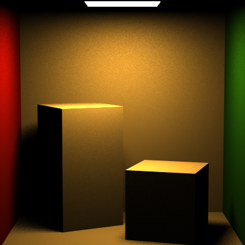
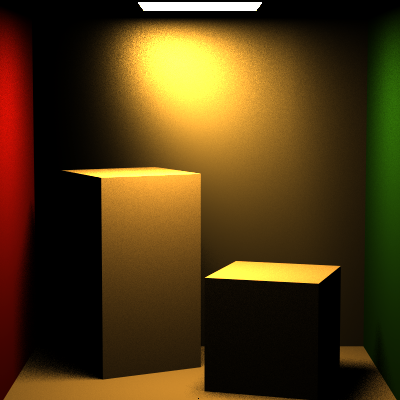
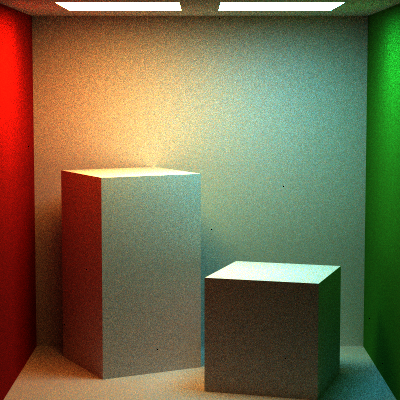
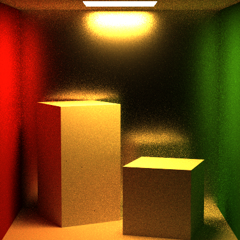
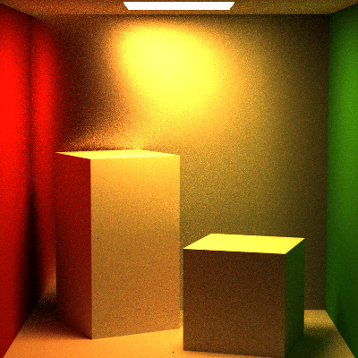
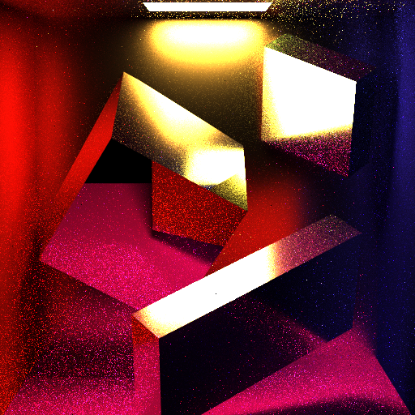
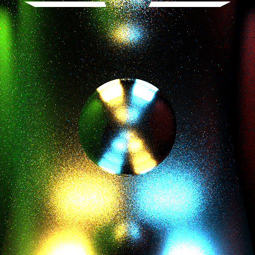
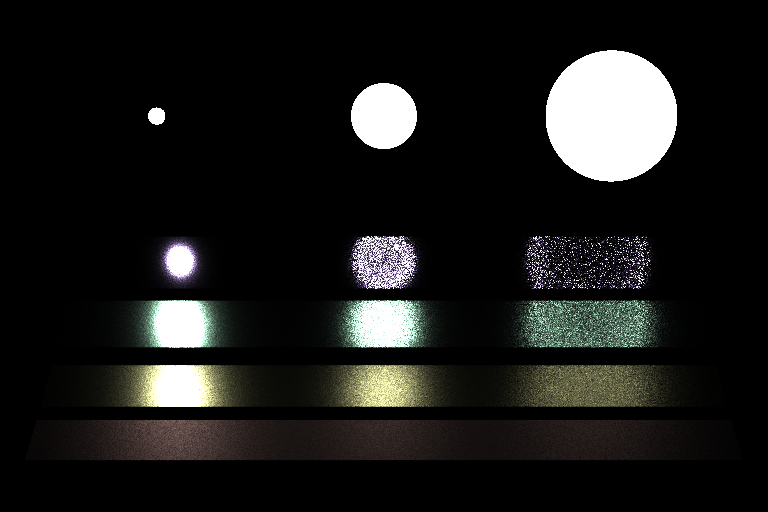
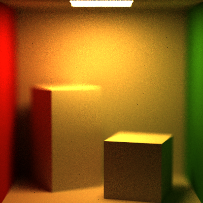

Monte Carlo path tracer in C++ built by extending a basic ray tracer, following Physically Based Rendering: From Theory to Implementation. Simulates global illumination by tracing light paths through the scene, with importance sampling to reduce noise, specular reflection for mirror-like surfaces, and a thin-lens camera model for depth of field.

For interest in the code, please reach out to me at eddieh@uchicago.edu

# Monte Carlo Path Tracer Renders

## Direct Lighting Estimation

## Global Illumination using Full Lighting Integrator

## Custom Scenes

## Veach Lighting Scene

## Thin Lens Camera

